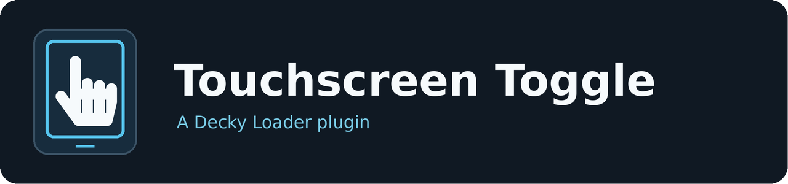
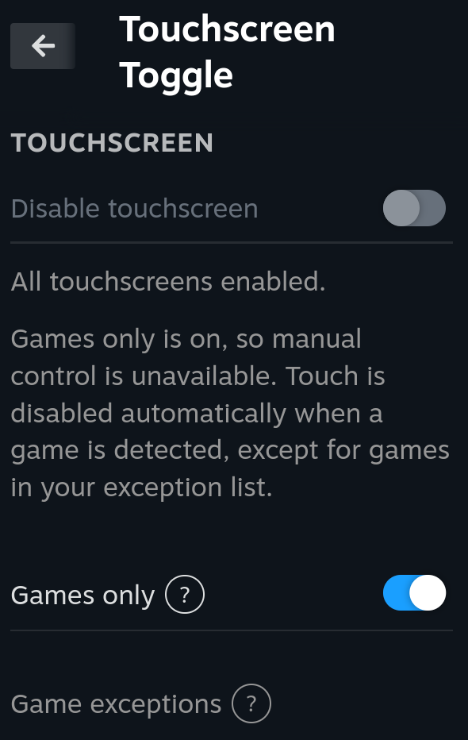
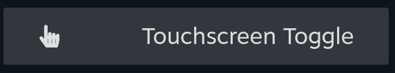

<p align="center">
  
</p>

# Touchscreen Toggle

A small [Decky Loader](https://github.com/SteamDeckHomebrew/decky-loader) plugin for controlling touchscreen input:

- **Disable touchscreen** turns touch off or on manually while Games only is off.
- **Games only** disables touch during games and restores it outside games.
- **Game exceptions** lets you choose installed games that should keep touch enabled.

## Screenshots

<table>
  <tr>
    <td valign="top" width="50%">
      <a href="assets/screenshots/settings.png"></a>
      <p>Settings with Games only enabled.</p>
    </td>
    <td valign="top" width="50%">
      <a href="assets/screenshots/decky-menu.png"></a>
      <p>Open Touchscreen Toggle from the Decky menu.</p>
    </td>
  </tr>
</table>

Captured on a Lenovo Legion Go S running Bazzite 45. The settings include controller-accessible **?** help. Controller and mouse input are not changed.

## Compatibility

**0.5 Beta** (`0.5.0`) is an early testing release. Hardware testing is limited to one Lenovo Legion Go S running Bazzite 45; broader testing is needed before 1.0.

Requires Linux, Decky Loader and a physical touchscreen with kernel input-inhibit support. Manual control and the screenshots above use the earlier external-helper build. The self-contained beta still needs a fresh device installation check.

Games-only automation remains experimental. Steam Deck/SteamOS and other handhelds have not yet been hardware-verified. Saved game exceptions remain if a game is uninstalled.

## Installation

This plugin is not yet listed in the Decky Plugin Store. If accepted, users will install and update it directly through Decky's store.

For development testing, download the versioned plugin ZIP from a successful [Build plugin](https://github.com/cwallace/decky-touchscreen-toggle/actions/workflows/build.yml) run and use Decky's manual plugin installer. Published [GitHub releases](https://github.com/cwallace/decky-touchscreen-toggle/releases) receive an installable plugin ZIP automatically.

Use `touchscreen-toggle-<version>.zip`, not GitHub's **Source code** archives. The source archives contain development files rather than the built plugin.

The touchscreen helper is bundled inside the plugin. Decky's `root` flag lets the backend control the kernel input-inhibit attribute; no separate installer, sudoers rule or system-wide helper is needed. Preferences stay in Decky's managed settings directory so updates preserve them.

## Build

Requires Node.js 24, pnpm 9.15.9 and Python 3.9 or newer.

```sh
pnpm install --frozen-lockfile
pnpm run typecheck
pnpm run build
python3 scripts/package.py
```

The installable ZIP is written to `dist/`. The standard Decky CLI also packages the bundled helper and notices; `defaults/` is flattened into the installed plugin directory.

## Releases

Pushes, pull requests and manual workflow runs build a plugin ZIP as a GitHub Actions artifact. They do not create a release.

To publish a new version after the workflow is on GitHub:

1. Update `package.json` and the helper's `VERSION` in `bin/touchscreen-control`, then commit and push the changes.
2. Create a GitHub release pointing to that commit, using a tag matching `package.json`, such as `v0.5.0`. The same version without the leading `v` is also accepted.
3. Mark beta versions as **prereleases**, then publish. Publishing a stable release or prerelease starts the build workflow.
4. Wait for **Build plugin** to finish. It validates the tag, builds the tagged source and attaches `touchscreen-toggle-<version>.zip` to the release.

GitHub supplies the **Source code (zip)** and **Source code (tar.gz)** downloads automatically. A mismatched tag stops the plugin build before an asset is attached. Existing assets are not overwritten automatically; rerunning an already completed upload requires resolving the duplicate asset first.

GitHub releases do not publish the plugin to the Decky marketplace.

## Recovery

Disabling touch affects Steam menus and Desktop Mode too. Keep a controller, mouse or keyboard available. To restore touch, turn off Games only and Disable touchscreen, or reboot. The plugin attempts to restore touchscreens it disabled when unloaded or removed; kernel inhibit state does not survive a reboot.

## License and credits

Plugin code: **GPL-2.0-only**, matching Decky Loader's GPLv2 license. See [LICENSE](LICENSE). Source and build instructions are available in [this repository](https://github.com/cwallace/decky-touchscreen-toggle).

Third-party components retain their own licenses:

- Decky plugin template: BSD-3-Clause, original copyright Steam Deck Homebrew; its notice is included in `defaults/licenses/decky-template.BSD-3-Clause.txt`.
- Bundled `@decky/api` 1.1.3: LGPL-2.1, [SteamDeckHomebrew/loader-api](https://github.com/SteamDeckHomebrew/loader-api); its license is included in `defaults/licenses/decky-api.LICENSE`.
- Font Awesome Free 5.15.4 **hand-pointer** artwork by Fonticons, Inc.: [CC BY 4.0](https://creativecommons.org/licenses/by/4.0/), [original SVG](https://github.com/FortAwesome/Font-Awesome/blob/5.15.4/svgs/solid/hand-pointer.svg). The design is unchanged and appears in the plugin and README logo; attribution is included in `defaults/licenses/font-awesome.LICENSE`.

Installed packages carry these notices under `licenses/`. React and Decky's UI are provided by Decky Loader, not bundled here. Build tools are not shipped in the plugin.

Most implementation code was generated with AI assistance.
